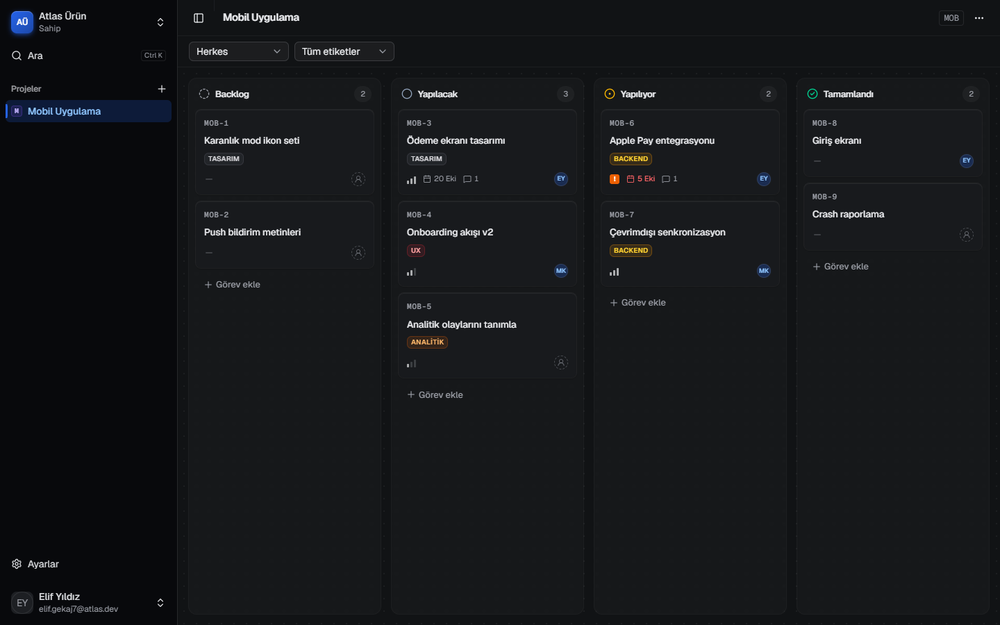
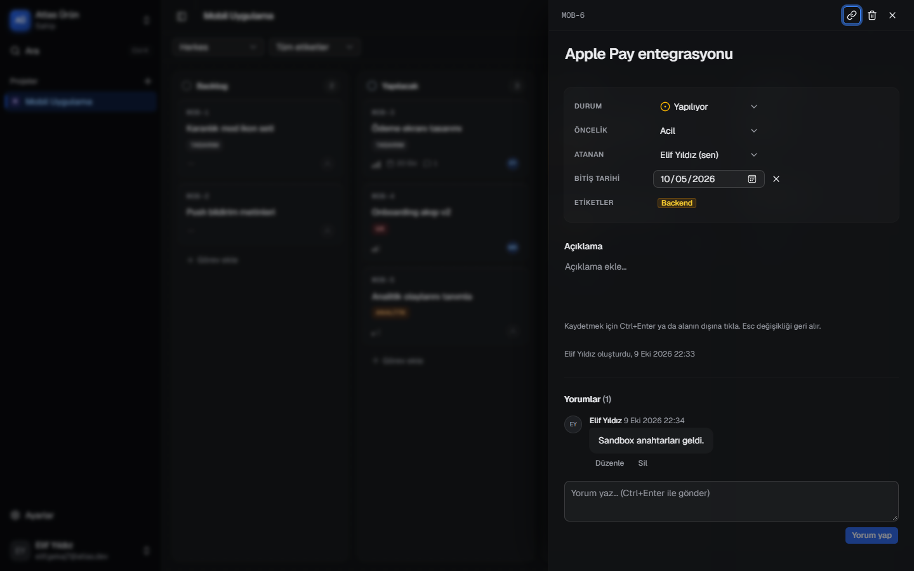
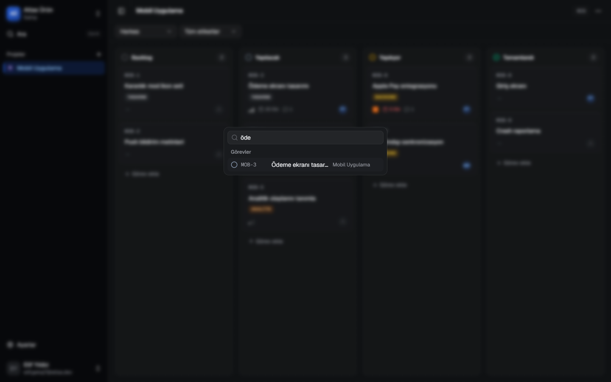
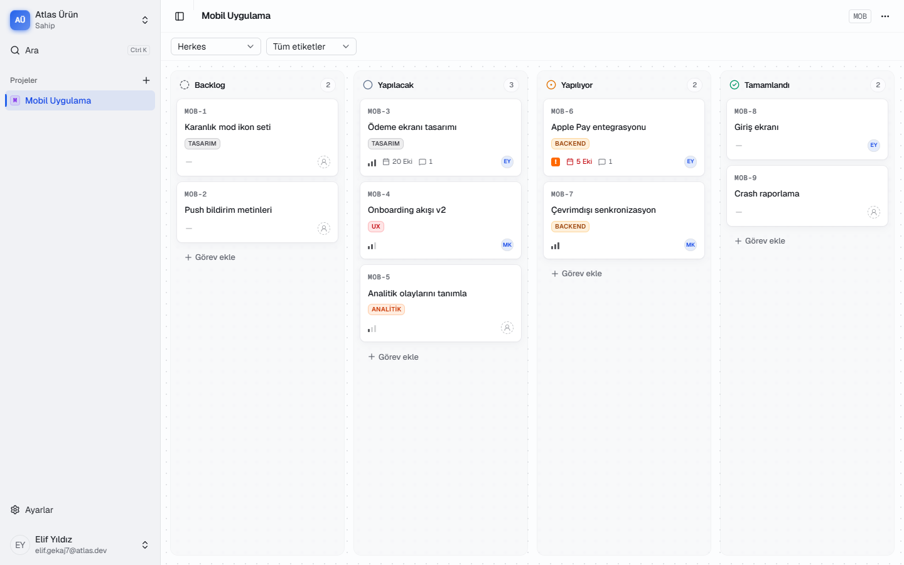
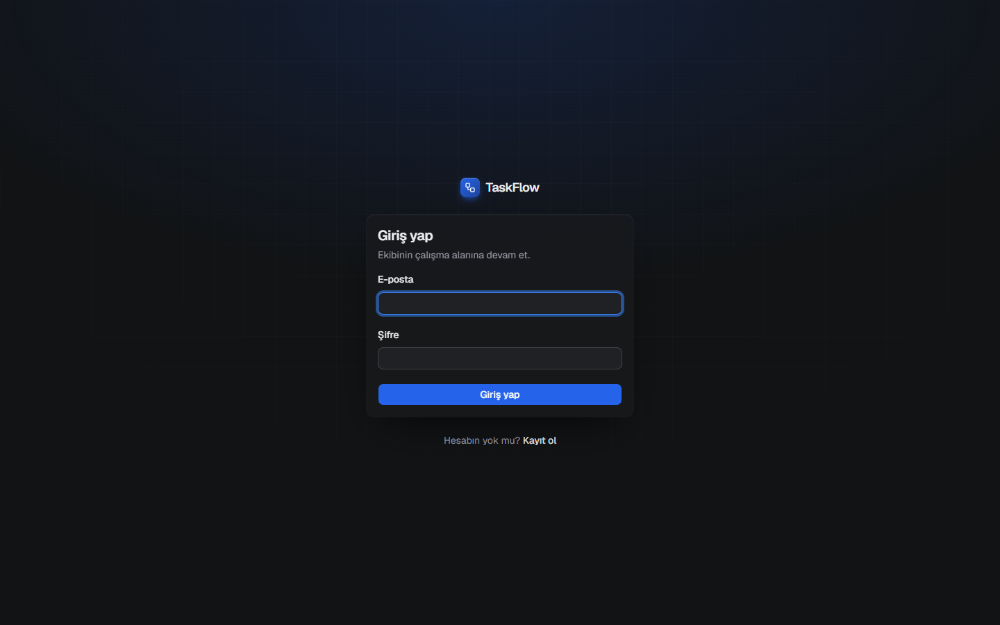

# TaskFlow

Ekipler için Linear tarzı proje ve görev yönetimi: workspace'ler, roller ve davetler, proje bazlı Kanban panosu, görev detay paneli, yorumlar ve komut paleti.

**Teknoloji:** Next.js 16 (App Router, Server Actions) · TypeScript · Tailwind CSS 4 · shadcn/ui (Base UI) · Prisma 7 + Postgres (Neon) · Better Auth · dnd-kit · Playwright




<table>
  <tr>
    <td></td>
    <td></td>
  </tr>
  <tr>
    <td></td>
    <td></td>
  </tr>
</table>

## Özellikler

- E-posta/şifre ile kayıt ve giriş
- Workspace oluşturma, link ile davet, roller (sahip / yönetici / üye)
- Projeler ve `MOB-12` biçiminde görev numaraları
- Kanban: sürükle-bırak (fare, dokunmatik, klavye), iyimser güncelleme, filtreler (URL'de)
- Görev paneli (`?task=MOB-12`): satır içi düzenleme, durum, öncelik, atama, bitiş tarihi, etiketler, yorumlar
- Komut paleti (Ctrl/Cmd+K) ve kısayollar (`C` yeni görev, `Esc` kapat)
- Açık/koyu tema, Türkçe arayüz, WCAG 2.1 AA taraması E2E testlerinde

## Kurulum

Gereksinimler: Node.js 24+, bir Postgres veritabanı (ör. [Neon](https://neon.tech)).

```bash
npm install
```

`.env.example` dosyasını `.env.local` olarak kopyalayıp değerleri doldur (bu dosya git'e girmez):

| Değişken | Açıklama |
|---|---|
| `DATABASE_URL` | Pooled bağlantı (uygulama) |
| `DIRECT_URL` | Direct bağlantı (migration) |
| `BETTER_AUTH_SECRET` | En az 32 bayt rastgele değer |
| `BETTER_AUTH_URL` | `http://localhost:3000` |

```bash
npm run db:deploy
```

```bash
npm run dev
```

Uygulama http://localhost:3000 adresinde açılır.

## Komutlar

| Komut | Ne yapar |
|---|---|
| `npm run dev` | Geliştirme sunucusu |
| `npm run build` / `npm start` | Production build ve sunucu |
| `npm run lint` | ESLint |
| `npm run typecheck` | Rota tiplerini üretip TypeScript kontrolü |
| `npm run test:e2e` | Playwright E2E testleri (production build, port 3100) |
| `npm run db:migrate` | Yeni migration oluştur ve uygula |
| `npm run db:studio` | Prisma Studio |
| `npm run screenshots` | README görüntülerini test veritabanındaki demo panodan yeniden üretir (`docs/screenshots`) |

E2E testleri varsayılan olarak `.env.local`'daki veritabanına yazar. Ayrı bir test veritabanı için `.env.test.local` dosyasına `DATABASE_URL` ve `DIRECT_URL` gir.

## CI

Her `main` push'unda ve pull request'te GitHub Actions lint, tip kontrolü, migration ve E2E testlerini çalıştırır (`.github/workflows/ci.yml`). Testler Neon `test` branch'ine bağlanır; bağlantı bilgileri repository secret olarak tutulur (`DATABASE_URL`, `DIRECT_URL`, `BETTER_AUTH_SECRET`). Hata durumunda Playwright raporu iş akışının çıktılarına eklenir.

## Belgeler

- [docs/PLAN.md](docs/PLAN.md): mimari, veri modeli, yetkilendirme, fazlar ve riskler
- [CLAUDE.md](CLAUDE.md): kod yazarken uyulan kurallar ve proje notları
